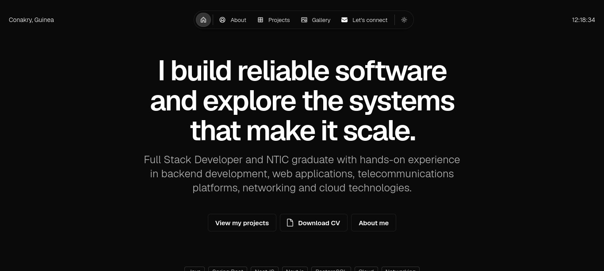

# Mamadou Barry — Portfolio

Personal portfolio of **Mamadou Barry**, Software Developer and NTIC graduate interested in **software engineering, backend development, distributed systems, networking and cloud technologies**.

🌐 **Live Portfolio:**  
https://portfolio-barry-mamadou.vercel.app/



---

## About

This portfolio presents my technical background, professional experience and selected projects across software development, networking, cloud technologies and IoT.

My current focus includes:

- Software Engineering
- Backend Development
- Full Stack Development
- Distributed Systems
- Cloud & DevOps
- Networking
- Software Architecture

---

## Featured Projects

### Telecom SaaS Platform

Full Stack development experience involving:

- NestJS
- Hexagonal Architecture
- RabbitMQ
- PostgreSQL
- Prisma
- Next.js
- Unit & E2E Testing
- Asynchronous processing

Due to confidentiality constraints, internal product screenshots and infrastructure visuals are not publicly shared.

---

### MedConnect

Secure medical appointment platform developed with:

- Java
- Spring Boot
- JWT
- MySQL
- Render
- Vercel

**Live Demo:**  
https://projet-odc-rdv.vercel.app/

---

### Campus LAN Design — UGANC

Academic network design project covering:

- TCP/IP
- VLAN segmentation
- Cisco Packet Tracer
- Network architecture
- Routing & Switching fundamentals
- Technical documentation

The original project screenshots were no longer available, so the current visuals were reconstructed to faithfully represent the original architecture and simulation.

---

### IoT Smart Home & Automated Dispenser

Team project involving:

- Internet of Things
- Automation
- Smart Home concepts
- Alexa integration
- Hardware/software collaboration

---

### IdentiGuinée

Hackathon project focused on digital identity, civil-registry automation and citizen services in Guinea.

My contribution included:

- Administration portal design
- Supabase/PostgreSQL database architecture
- Simulated NaissanceChain registry
- Automated identity-verification workflow
- Cross-verification API integration

Technologies used include:

- React
- Vite
- Supabase
- PostgreSQL
- Vercel
- NaissanceChain

**Live Demo:**  
https://portailidentguinee.vercel.app/

---

## Tech Stack

### Frontend

- Next.js
- React
- TypeScript
- JavaScript
- HTML
- CSS

### Backend

- NestJS
- Spring Boot
- Java
- REST APIs
- JWT
- RabbitMQ

### Databases

- PostgreSQL
- MySQL
- Supabase
- Prisma

### Software Engineering

- Hexagonal Architecture
- Unit Testing
- End-to-End Testing
- Git
- GitHub
- API Integration

### Cloud & DevOps

- Docker
- Vercel
- Render
- Cloudinary

### Networking & Systems

- TCP/IP
- VLAN
- Cisco Packet Tracer
- Routing & Switching fundamentals
- Linux
- Windows

---

## Portfolio Stack

This portfolio is built with:

- **Next.js 16**
- **React 19**
- **TypeScript**
- **Once UI**
- **Sass / SCSS Modules**
- **MDX**

Projects and case studies are managed through MDX files.

---

## Project Structure

```text
src/
├── app/
│   ├── about/
│   ├── gallery/
│   └── work/
│       └── projects/
├── components/
├── resources/
│   ├── content.tsx
│   └── once-ui.config.ts
└── utils/

public/
├── images/
│   ├── gallery/
│   ├── og/
│   ├── profile/
│   └── projects/
└── Mamadou_Barry_CV.pdf
```

---

## Getting Started

### 1. Clone the repository

```bash
git clone YOUR_REPOSITORY_URL
```

### 2. Install dependencies

```bash
npm install
```

### 3. Start the development server

```bash
npm run dev
```

Open:

```text
http://localhost:3000
```

---

## Build

Run the production build with:

```bash
npm run build
```

Start the production server with:

```bash
npm run start
```

TypeScript can be checked with:

```bash
npx tsc --noEmit
```

---

## Content Management

Main profile and portfolio content:

```text
src/resources/content.tsx
```

Theme and global configuration:

```text
src/resources/once-ui.config.ts
```

Project case studies:

```text
src/app/work/projects/
```

Each case study is written using MDX.

---

## Gallery

The Gallery contains personal and event-related photos from my journey, including technology events, hackathons and other relevant moments.

Project-specific images remain attached to their respective case studies.

---

## Contact

**Mamadou Barry**

Email:  
mb624064783@gmail.com

LinkedIn:  
https://www.linkedin.com/in/mamadou-barry-6769bb2bb

GitHub:  
https://github.com/barrymamadou2026

Portfolio:  
https://portfolio-barry-mamadou.vercel.app/

---

## Deployment

The portfolio is deployed with **Vercel**.

Production URL:

https://portfolio-barry-mamadou.vercel.app/

---

## Credits

This portfolio is based on the open-source **Magic Portfolio** template built with **Once UI**.

- Magic Portfolio: https://github.com/once-ui-system/magic-portfolio
- Once UI: https://once-ui.com/
- Next.js: https://nextjs.org/

The original template architecture and design system were customized to reflect my own profile, experience, projects and visual identity.

---

## License

The original Magic Portfolio template is distributed under the **CC BY-NC 4.0 License**.

Attribution to the original authors and Once UI is preserved.

See the repository `LICENSE` file for full licensing information.

---

## Author

**Mamadou Barry**

Software Developer  
Software Engineering · Systems · Cloud · Networking

GitHub: https://github.com/barrymamadou2026  
LinkedIn: https://www.linkedin.com/in/mamadou-barry-6769bb2bb